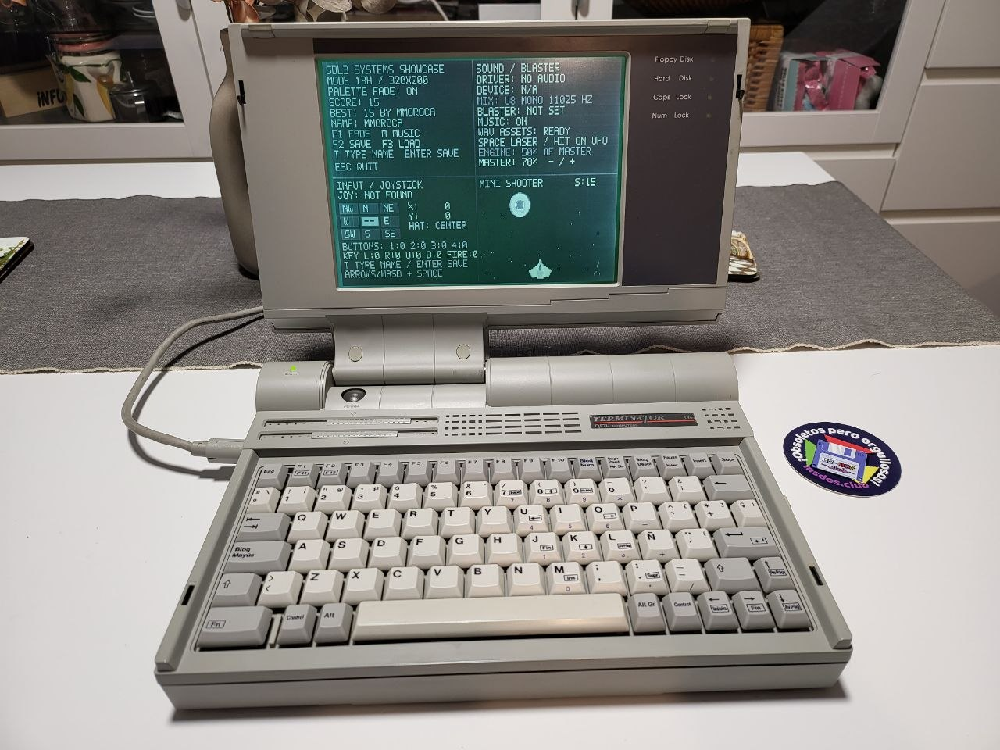

# SDL3 DOS 386 — Real-Hardware 80386 / 386SX (2 MB RAM, No-FPU) Edition

**English** | [Español](README.es.md)

> [!TIP]
> **Sister Repository (`486DX+` / Pentium / DOSBox Reference Suite):** Looking for clean, minimal, idiomatic SDL3 MS-DOS example code without low-level DPMI/linker hooks (`4+ MB` RAM systems and modern emulators)? Visit the companion main repository **[`mmoroca/sdl3-dos-demo`](https://github.com/mmoroca/sdl3-dos-demo)**, from which this `80386` edition originates.

A standalone, hardware-validated C11 collection of **SDL3 MS-DOS (`320×200` `INDEX8` VGA Mode 13h)** demos, tools, and arcade games engineered from the ground up to run at **486-class smoothness with zero disk swap (`CWSDPMI.SWP = 0`) on real 1990–1992 `80386SX` / `80386DX` PCs with only `2 MB` of total RAM and no `80387` FPU** — without modifying a single file inside the upstream `SDL/` submodule.

Developed by **@mmoroca & [Arena.AI](http://arena.ai/) 2026**.

---

## Real-Hardware Validation: ADL Computers Terminator 386

Validated on real early-1990s silicon (**ADL Computers Terminator 386** — Intel `80386SX`, `2 MB` total RAM, no `80387` FPU, passive-matrix standard non-VESA ISA VGA LCD, MS-DOS + `CWSDPMI.EXE`), running every demo and full-screen game smoothly with **`Hard Disk` activity LED completely off (`0 B` virtual swap)** — as well as DOSBox / DOSBox-X / FreeDOS and modern desktop platforms (Linux, Windows, macOS).



> **Tried it on your own retro DOS machine?** Whether it is a `386SX`, `386DX`, `486SX`, `486DX`, classic portable, PS/2, or ISA clone, feel free to drop us a note in **[GitHub Issues](https://github.com/mmoroca/sdl3-dos-386/issues)** sharing your machine model, CPU, RAM, video/sound card, and how it runs!

---

## Programs Included

All eight executables fit comfortably inside the **`~795 KB` physical XMS ceiling** of a `2 MB` DOS system under `CWSDPMI.EXE` (`~508 KB – 574 KB` total image footprint):

| DOS Target | Source File | Resident Size (`.text+.data+.bss`) | Highlights & 386 Optimizations |
| :--- | :--- | :---: | :--- |
| **`HELLO.EXE`** | [`main.c`](main.c) | `507,928 B` | Minimal `320×200` `INDEX8` starter skeleton linking `dos_compat.c` (`0%` idle ISA traffic). |
| **`MISTIFY.EXE`** | [`mistify.c`](mistify.c) | `512,024 B` | Classic bouncing-polygon screensaver using `16.16` fixed-point math (`0` float instructions) and VGA DAC cycling. |
| **`FONTDEMO.EXE`** | [`fontdemo.c`](fontdemo.c) | `516,632 B` | Multi-font UTF-8 renderer (`3×5`, `5×7`, and full Spanish `8×8` with `áéíóúüñ` & `¡¿`) stored in `.rodata` (`0 B` heap). |
| **`SBTEST.EXE`** | [`soundtest.c`](soundtest.c) | `540,184 B` | Integer `SDL_AUDIO_U8` (`11025 Hz` mono) synthesizer and live Sound Blaster / `BLASTER` diagnostic panel. |
| **`MODPLAY.EXE`** | [`modplay.c`](modplay.c) | `550,424 B` | 4-channel ProTracker `.MOD` mixer in `16.16` integer fixed-point with 10 Hz dirty-rect UI updates. |
| **`DINO.EXE`** | [`dinorun.c`](dinorun.c) | `564,760 B` | **Dino Fall** obstacle-placement game featuring `0 B` transient heap streaming `.BMP` loading, 1-bit wrap-padded `Uint32` LUT `TRACK.BMP` scrolling, 1-bit collision masks, and zero-`imul` analytical dirty strips. |
| **`SHOWCASE.EXE`** | [`showcase.c`](showcase.c) | `567,832 B` | 4-panel starter template (system info, `U8` audio mixer, live keyboard/joystick/text inspector, mini-shooter). See [`SHOWCASE_GUIDE.md`](SHOWCASE_GUIDE.md). |
| **`SHOOTER.EXE`** | [`shooter.c`](shooter.c) | `574,488 B` | Full-screen arcade shooter scaling up to **256 simultaneous active UFOs** on a real `386SX` via pre-baked RLE spans + `Uint32` bitmask collisions and `F` autofire for 2KRO keyboards. |


> **Optional diagnostic logging (`/L`)**: File logging is **disabled by default** in every program so real-time gameplay never stalls on slow IDE/CF FAT16 seeks. Pass `/l` (or `/log`) on the DOS command line (for example `SHOOTER.EXE /L` or `SHOWCASE.EXE /L`) whenever you want diagnostic `.LOG` files written to disk.

---

## Tuning `CONFIG.SYS`, `AUTOEXEC.BAT` & `CWSDPMI.EXE` for `2 MB` RAM PCs

On an `80386` with only **`2 MB` (`2,048 KB`) of total RAM**, only **`1,024 KB` of physical Extended Memory (XMS)** exists above `1 MB`. Every kilobyte consumed at boot by disk caches (`SMARTDRV`), expanded-memory emulators (`EMM386`), or TSRs directly reduces the physical RAM available to 32-bit DJGPP/SDL3 programs — forcing `CWSDPMI.EXE` to page memory to `C:\CWSDPMI.SWP` on disk.

### Recommended Clean Setup (`2 MB` RAM — Maximum XMS & Zero Swap)

1. Place **`CWSDPMI.EXE`** (from the official DJGPP `csdpmi*b.zip` package) either in the same directory as the `.EXE` files or inside a folder on your `PATH` (such as `C:\DOS`).
2. Keep **`CONFIG.SYS`** minimal so **`CWSDPMI.EXE` runs directly over `HIMEM.SYS` (raw XMS / Ring 0)** without `EMM386.EXE`:

```dos
DEVICE=C:\DOS\HIMEM.SYS /TESTMEM:OFF
DOS=HIGH
FILES=20
BUFFERS=15
STACKS=9,256
```

3. Avoid loading **`SMARTDRV.EXE`** or heavy XMS-resident TSRs in **`AUTOEXEC.BAT`**:

```dos
@ECHO OFF
PROMPT $P$G
PATH C:\DOS

REM Optional — set ONLY if your machine actually has a Sound Blaster / compatible card:
REM SET BLASTER=A220 I5 D1 T3
```

### Why These Settings Make a Night-and-Day Difference on `2 MB` Systems

- **Do NOT load `SMARTDRV.EXE` in `2 MB` mode**: By default on a `2 MB` PC, `SMARTDRV` reserves **`256–512 KB` of physical XMS** for disk caching, starving `CWSDPMI` down to `< 400 KB` of RAM and forcing heavy swap!
- **Skip `EMM386.EXE` unless another program requires EMS**: Under `EMM386`, `CWSDPMI` must run via **VCPI** inside Virtual 8086 mode instead of native XMS mode, losing **`~64–160 KB` of extended RAM** to VCPI page tables and adding extra CPU overhead on hardware interrupts.
- **MS-DOS 6.0 / 6.22 Multi-Boot Tip**: You do not need to overwrite your everyday setup! Add a clean `[GAME386]` menu entry to `C:\CONFIG.SYS` and `C:\AUTOEXEC.BAT` so you can choose between your regular environment and pure XMS at boot:

```dos
[MENU]
MENUITEM=NORMAL,Standard MS-DOS Environment
MENUITEM=GAME386,Clean 386 DPMI Mode (Max XMS - No Swap)
MENUDEFAULT=NORMAL,5

[GAME386]
DEVICE=C:\DOS\HIMEM.SYS /TESTMEM:OFF
DOS=HIGH
FILES=20
BUFFERS=15
STACKS=9,256

[NORMAL]
REM Your existing CONFIG.SYS lines here...
```

---

## Engineering Guide: How to Make SDL3 Fly on a Real `80386SX` (`2 MB` RAM, No FPU)

Every source file in this repository ([`CMakeLists.txt`](CMakeLists.txt), [`dos_compat.c`](dos_compat.c), [`dinorun.c`](dinorun.c), [`shooter.c`](shooter.c), [`showcase.c`](showcase.c), [`modplay.c`](modplay.c)) is heavily commented so you can study the exact hardware root causes and reuse every technique directly in your own SDL3/DOS software.

### 1. Understanding the Physical `2 MB` RAM Cliff (`~795 KB` Free XMS)

On a `2 MB` (`2,048 KB`) `80386SX` PC running MS-DOS + `HIMEM.SYS` (`DOS=HIGH`) + `CWSDPMI.EXE`:

- `0 – 640 KB`: Conventional RAM (MS-DOS kernel, drivers, real-mode DPMI stub).
- `640 – 1024 KB`: Upper Memory Area (VGA `0xA0000` framebuffer, BIOS ROMs).
- `1024 – 2048 KB`: **Only `1,024 KB` of Extended Memory (XMS) exists in hardware.**

Once `HIMEM.SYS` and `CWSDPMI` allocate page tables and transfer buffers, **only `~795 KB` of physical XMS pages remain available** for your entire 32-bit process:

$$\text{Code (`.text`)} + \text{Data/BSS} + \text{Stack (`_stklen`)} + \text{Peak Heap (`sbrk()`)} \le \mathbf{\sim 795\text{ KB}}$$

Four hidden DJGPP traps blow past `795 KB` unless explicitly solved:

1. **DJGPP's `512 KB` default stack**: By default, `_stklen` reserves `512 KB` of physical RAM before `main()` runs — eating two thirds of all XMS on a `2 MB` PC. Defining `unsigned _stklen = 65536U;` (`64 KB`) in [`dos_compat.c`](dos_compat.c) immediately frees **`448 KB`** of physical RAM.
2. **DJGPP's monotonic `sbrk()` high-water mark**: Calling `free()` in DJGPP **never returns pages to `CWSDPMI`**. If a temporary allocation at startup (such as `SDL_LoadBMP("Images/OTHER/TRACK.BMP")` adding `68 KB` on top of `738 KB` = `806 KB > 795 KB`) crosses physical XMS for even **1 millisecond**, `CWSDPMI` creates `C:\CWSDPMI.SWP` and thrashes the disk continuously during gameplay!
3. **Hidden `malloc(4096)` inside `stdio` `fread()`**: Calling `fopen()` + `fread()` without `setvbuf()` causes DJGPP's `_filbuf()` to lazily `malloc(4,096)` bytes on the heap. Calling `setvbuf(fp, stack_buf, _IOFBF, 512)` with a stack buffer before the first `fread()` reduces transient heap usage to **literally `0` bytes**.
4. **Never set `_CRT0_FLAG_LOCK_MEMORY` globally across `main()`**: `SDL_RunApp()` already locks `.text + .data + .bss + stack` for hardware ISRs and clears `_CRT0_FLAG_LOCK_MEMORY` right before entering `main()`. Pinning heap pages exhausts `CWSDPMI`'s lockable page pool prematurely.

---

### 2. Zero-Heap Streaming `.BMP` Loading & Pre-Baked RLE (`dinorun.c` & `shooter.c`)

- **Streaming row-by-row `.BMP` decoding (`IndexedBmpStream` in [`dinorun.c`](dinorun.c))**: Reads one scanline at a time directly into scaled opaque runs (`PreparedSpan`) and `1 bit/pixel` collision masks (`8×` smaller than byte masks). Because nothing references `SDL_LoadBMP_IO`, `-Wl,--gc-sections` dead-strips SDL's entire BMP codec (`~20 KB` saved in `.text`) and peak transient heap during asset loading is **`0 bytes`**.
- **Hardware audio pre-probing ([`shooter.c`](shooter.c), [`showcase.c`](showcase.c))**: Always open the hardware SDL audio device **before** loading `.WAV` PCM clips (`~291 KB` in `SHOWCASE/`). On `2 MB` `386SX` laptops without a Sound Blaster card, zero WAV bytes are ever allocated on the heap.
- **Immediate splash release ([`shooter.c`](shooter.c))**: Destroy full-screen `320×200` (`64 KB`) splash surfaces immediately when transitioning into `PHASE_TITLE`.

---

### 3. `1-Bit` Wrap-Padded `Uint32` Nibble-LUT Scrolling (`TRACK.BMP` in `dinorun.c`)

`Images/OTHER/TRACK.BMP` (`2404 × 28`) represents `67,312` pixels (`68 KB` raw surface), yet uses a single opaque ink color over transparent pixels:

1. `load_track_streaming()` packs all `2,404` columns into **1 bit/pixel** (`g_track_bits` in `.bss`) and appends **`328` bits (`SCREEN_WIDTH + 8`) of circular wraparound padding** (`x % width`) right after column `2,403`.
2. A 16-entry `Uint32` lookup table (`g_track_lut4[16]`, `64 bytes` total — permanently hot in cache/prefetch) maps every 4-bit nibble directly to **4 `INDEX8` pixels packed in one 32-bit word**.
3. `draw_ground()` reads one unaligned shift window `(word >> bit_shift) & 0xFF` and emits **8 horizontal pixels per iteration (`2 × Uint32` stores)** with **zero branches, zero wraparound seam checks, zero multiplications, and `0 B` of heap** — taking **`~0.6 ms/frame`** on a `16 MHz 386SX`!

---

### 4. Eliminating `imul` Hashing & Cutting `8 MHz` ISA VGA Traffic (`dinorun.c` + `dos_compat.c`)

- **Why framebuffer hashing kills an `80386`**: On an `80386`, a 32-bit `imul` takes **`9 – 38` cycles** (vs `1 – 3` cycles on modern CPUs). Hashing `16,000` dwords per frame (`64,000 B`) burns **`~800,000` cycles (`~50 ms/frame` at `16 MHz`)** before drawing a single sprite!
- **Analytical 25-bit dirty-strip bitmask (`Uint32`)**: Dividing `320×200` into `25` horizontal strips of `8` scanlines fits inside a **single 32-bit register**:
  ```c
  g_cur_dirty_strips |= ((2U << s1) - (1U << s0));
  ```
  - **Partial `memset` clear**: `draw_game()` clears **only `prev_dirty_strips`** (the strips actually drawn on frame $t-1$), cutting background clear cost by `~40%`.
  - **Partial ISA `0xA0000` transfer**: `present_game_frame()` coalesces contiguous set bits in `cur_dirty_strips | prev_dirty_strips` and passes full-width bands to `__wrap_DOSVESA_UpdateWindowFramebuffer()`, copying **only modified scanlines** across the wait-state-heavy ISA bus (`-19%` to `-29%` bus bandwidth during gameplay).
  - **Static-screen short-circuit**: In `MODE_TITLE`, `MODE_PAUSED`, `MODE_GAME_OVER`, and `MODE_NAME_ENTRY` (between keystrokes), `draw_game()` returns immediately with **`0` bytes written to RAM/VRAM and `0%` CPU load**.

---

### 5. CPU ISA, `CPU_haveCPUID` (`SDL#16573`), and Zero-Float Audio/Physics

- **Strict `i386` codegen**: Always compile both SDL3 and application sources with `-march=i386 -mtune=i386` so GCC never emits `486+` instructions (`bswap`, `cmpxchg`, `xadd`) or `686` `cmov*` instructions (`SIGILL` on `80386`).
- **Upstream `CPU_haveCPUID()` inline assembly fix ([`libsdl-org/SDL#16573`](https://github.com/libsdl-org/SDL/pull/16573))**: Unpatched SDL3 used `: "=m" (has_CPUID)` after `int has_CPUID = 0;`, allowing GCC dead-store elimination (`-O2`/`-Os`) to delete the zero initialization and conclude an `80386` has `CPUID`, executing `0F A2` -> **`SIGILL` crash at startup**! Passing `-fno-tree-dse -fno-dse` in `CMakeLists.txt` protects unpatched checkouts automatically; [`libsdl-org/SDL#16573`](https://github.com/libsdl-org/SDL/pull/16573) fixes it permanently with `: "+r" (has_CPUID)` and `"cc"`.
- **FPU-less `386SX` & `libemu.a`**: Link `-Wl,--whole-archive -lemu -Wl,--no-whole-archive` so startup/shutdown x87 instructions inside `libc`/`SDL` do not crash with `SIGNOFP`, **and eliminate `100%` of per-frame `float`/`double` operations** (each emulated x87 `INT 7` trap costs **`~3,000+` cycles**!). Always pause `SDL_AudioStream` devices when silent so SDL's background resampler never runs float conversion on empty queues.

---

### 6. Pure Protected-Mode IRQ 1 Keyboard, PIT Timer & Non-VESA VGA (`dos_compat.c`)

Using GNU `ld` `--wrap=...` symbol interposition (**zero patches inside `SDL/`**), [`dos_compat.c`](dos_compat.c) replaces five severe `386` bottlenecks in one drop-in object library:

| Wrapped Symbol | Real-Hardware `80386` Bottleneck Solved |
| :--- | :--- |
| `DOS_HookInterrupt` / `DOS_UnhookInterrupt` | Installs a locked pure 32-bit DPMI `IRET` wrapper directly on `INT 09h` without chaining to real-mode BIOS (`0` protected↔real mode world switches while holding keys). |
| `__dpmi_int` (`0x16`) | Answers SDL's per-frame `INT 16h` BIOS keyboard check immediately in 32-bit mode (`ZF = 1`), saving ~60 real-mode reflections/sec. |
| `SDL_SendKeyboardKey` / `SDL_SendKeyboardText` | Drops `30 Hz` hardware typematic repeat floods on held movement/fire keys (keeping `Backspace` repeat) and skips `malloc`-heavy UTF-8 text events when `SDL_TextInputActive()` is false. |
| `DOSVESA_SetDisplayMode` | Guards `mode->internal == NULL` so standard 1990–1991 non-VESA VGA cards cleanly restore `80×25` text mode (`INT 10h AX=0003h`) on exit. |
| `DOSVESA_UpdateWindowFramebuffer` | Runs full SDL presentation on frame 1 (programming the 256-color VGA DAC `0x3C8/0x3C9`), then `dosmemput()`s only dirty horizontal bands to `0xA0000`. |
| `SDL_SYS_DelayNS` | Replaces `delay()` (`rdtsc` `SIGILL` on 386/486 or broken BIOS `INT 15h AH=86h` hangs) with universal Intel 8254 PIT `uclock()` + `DOS_Yield()`. |

---

## Cross-Compiling for DOS (`80386` / `2 MB` RAM)

1. Clone with submodules (or initialize the external `SDL/` submodule — SDL3 is never vendored or modified):

```bash
git clone --recurse-submodules https://github.com/mmoroca/sdl3-dos-386.git
cd sdl3-dos-386
```

2. Configure and build all stripped `i386` DOS executables using your DJGPP cross-toolchain (`CMakeLists.txt` applies `-Os -march=i386 -mtune=i386 -fno-tree-dse -fno-dse -ffunction-sections -fdata-sections -Wl,--gc-sections -Wl,--whole-archive -lemu -Wl,--no-whole-archive` and `--wrap=...` automatically when `CMAKE_SYSTEM_NAME=DOS`):

```bash
cmake -S . -B build-dos \
  -DCMAKE_SYSTEM_NAME=DOS \
  -DCMAKE_C_COMPILER=i586-pc-msdosdjgpp-gcc \
  -DCMAKE_AR=i586-pc-msdosdjgpp-ar \
  -DCMAKE_RANLIB=i586-pc-msdosdjgpp-ranlib \
  -DCMAKE_STRIP=i586-pc-msdosdjgpp-strip \
  -DCMAKE_BUILD_TYPE=Release

cmake --build build-dos -j
```

3. Copy the compiled `.EXE` files together with `CWSDPMI.EXE`, `Images/`, and `SHOWCASE/` to your DOS drive.

### Reusing `dos_compat` in Your Own SDL3/DOS Project

Copy [`dos_compat.c`](dos_compat.c) into your project and copy the `if(CMAKE_SYSTEM_NAME STREQUAL "DOS")` compile options plus `add_library(dos_compat OBJECT dos_compat.c)` block from [`CMakeLists.txt`](CMakeLists.txt), then link your target with:

```cmake
target_link_libraries(your_game PRIVATE dos_compat)
```

---

## Related Repositories

- **[`mmoroca/sdl3-dos-demo`](https://github.com/mmoroca/sdl3-dos-demo)** — Clean, idiomatic reference edition of the SDL3 MS-DOS Demo Suite targeting `486DX+` (`4+ MB` RAM), DOSBox / DOSBox-X, and modern desktop platforms.
- **[`mmoroca/sdl3-dos-386`](https://github.com/mmoroca/sdl3-dos-386)** — Low-memory, FPU-less `80386 / 386SX` (`2 MB` RAM, ISA VGA) optimized edition + reusable `dos_compat.c` layer.
- **[`libsdl-org/SDL#16573`](https://github.com/libsdl-org/SDL/pull/16573)** — Upstream pull request fixing `CPU_haveCPUID()` inline assembly on `i386` (`80386` / `80486` CPUs without `CPUID`).

---

## Asset Pipeline & Custom Bitmap Fonts (No Pillow Required)

- **`tools/convert_assets.py`**: Standalone Python 3 standard-library converter (`zlib` + `struct` only — **no Pillow dependency**) converting arbitrary PNG directory trees recursively to DOS `8.3` 8-bit uncompressed `.BMP` files using the shared 256-color RGB `3:3:2` palette (`index 5` transparent key).
- **`tools/genfont.py`**: Dependency-free `.PNG` sprite-sheet to C `.rodata` header converter supporting full Unicode / UTF-8 codepoint tables (`fonts/font_3x5.h`, `fonts/font_5x7.h`, `fonts/nueva_font_5x7.h`, `fonts/font_8x8.h`).

---

## Licenses & Credits

- **Original C source code, 80386 compatibility layer (`dos_compat.c`), and Python tools**: Released under the **MIT License** — by **@mmoroca & [Arena.AI](http://arena.ai/) 2026**. See [`LICENSE`](LICENSE).
- **SDL3 (`SDL/`)**: External Git submodule distributed under the **zlib License** (`https://github.com/libsdl-org/SDL`). SDL3 is not vendored or relicensed here; see [`THIRD_PARTY_NOTICES.md`](THIRD_PARTY_NOTICES.md).
- **Showcase & Shooter game art / audio (`SHOWCASE/`)**: Space Shooter Remastered by [Kenney](https://kenney.nl), dedicated to the public domain under **CC0 1.0 Universal** (voluntary attribution; MIT is not applied to these assets).
- **Dino Fall sprites (`Images/`)**: Authored for [`mmoroca/sdl3-dino-fall`](https://github.com/mmoroca/sdl3-dino-fall) and included here with permission of `@mmoroca` (their original asset terms apply; they are not relicensed under MIT).
